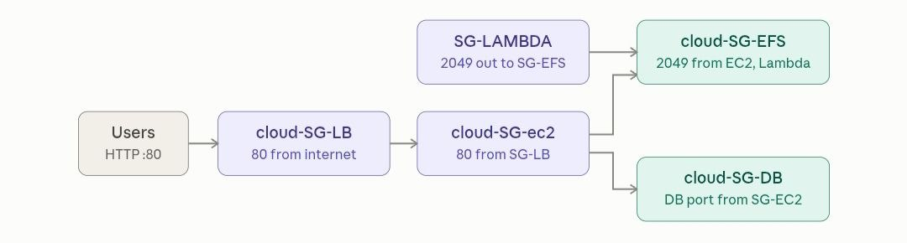
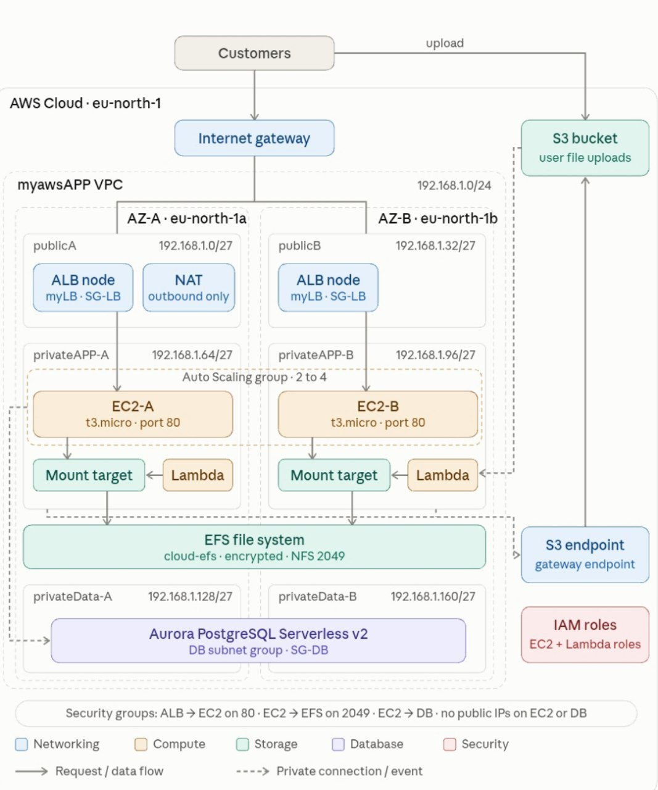

# aws-cloud-infrastructure
AWS cloud infrastructure using CloudFormation, VPC, ALB, Auto Scaling, S3, Lambda, ,security groups, EFS and Aurora PostgreSQL
# # security-groups

# # AWS Architecture

